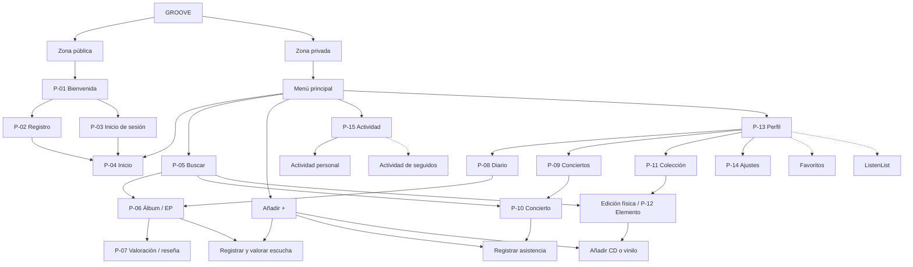

# Estructura de navegación Groove

## 1. Objetivo

Definir la navegación de Groove de forma intuitiva, coherente y adaptable a distintos dispositivos, permitiendo consultar información musical, registrar experiencias y gestionar la identidad musical de cada usuario.

La estructura combinará dos dimensiones:

- **Personal:** registro de escuchas, valoraciones, reseñas, conciertos y colecciones musicales.
- **Social:** descubrimiento de contenido, actividad de otros usuarios e interacción dentro de una comunidad musical.

La primera versión ofrecerá una experiencia personal completa. Las funcionalidades sociales se incorporarán progresivamente. La navegación se dividirá en **zona pública** y **zona privada**.

## 2. Zona pública

Destinada a visitantes que no tengan una sesión autenticada.

| ID | Pantalla | Responsabilidad |
|---|---|---|
| P-01 | Bienvenida | Presentar Groove y ofrecer acceso al registro y al inicio de sesión. |
| P-02 | Registro | Crear una cuenta mediante nombre de usuario, correo electrónico y contraseña. |
| P-03 | Inicio de sesión | Autenticar al usuario mediante credenciales. |

Tras registrarse y establecer una sesión válida, o iniciar sesión correctamente, el usuario será redirigido a **Inicio**.

Groove permitirá conservar la sesión entre accesos desde el mismo dispositivo o navegador mientras siga siendo válida. Si hay una sesión válida, se accederá directamente a la zona privada; en caso contrario, será necesario autenticarse nuevamente.

## 3. Zona privada

Requerirá autenticación y constituirá el núcleo funcional de la aplicación.

La navegación principal tendrá cinco elementos:

1. **Inicio**.
2. **Buscar**.
3. **Añadir**.
4. **Actividad**.
5. **Perfil**.

La navegación permanecerá disponible de forma persistente, adaptada al dispositivo y al contexto. Las fichas, registros personales y formularios podrán abrirse desde diferentes secciones mediante enlaces contextuales.

### 3.1. Inicio

Será la página principal y el destino predeterminado tras acceder a una sesión autenticada.

- **MVP:** resumen de la actividad musical personal, registros recientes, información general y accesos a las funcionalidades principales.
- **Evolución:** descubrimiento musical personalizado, actividad destacada de usuarios seguidos, contenidos populares y recomendaciones.

A diferencia de Actividad, Inicio ofrecerá información seleccionada y resumida, no un historial estrictamente cronológico.

### 3.2. Buscar

Permitirá localizar contenido musical y acceder a sus fichas de información.

- **MVP:** búsqueda de álbumes y EPs por título o artista, así como de conciertos y ediciones físicas.
- **Evolución:** búsqueda de perfiles de usuarios y herramientas de exploración y descubrimiento musical.

**Decisión pendiente de diseño técnico:** concretar las fuentes y el comportamiento de búsqueda de conciertos y ediciones físicas durante el MVP, que amplían el alcance del catálogo descrito originalmente en la especificación.

### 3.3. Añadir

Será una **acción rápida** de la navegación principal, no una sección de almacenamiento de contenido.

El usuario podrá seleccionar entre:

1. Registrar y valorar una escucha de un álbum o EP.
2. Registrar la asistencia a un concierto.
3. Añadir un CD o vinilo a su colección física.

Tras elegir una operación, se abrirá el buscador o formulario que corresponda. Estas operaciones también podrán iniciarse desde las fichas musicales relacionadas.

Registrar una escucha no obligará a asignar una valoración, de acuerdo con las reglas generales del proyecto.

### 3.4. Actividad

Mostrará un historial **cronológico** de acontecimientos musicales registrados en Groove.

- **MVP:** actividad privada del propio usuario: escuchas, valoraciones, reseñas, conciertos y nuevas incorporaciones a la colección.
- **Versión social:** actividad pública de los usuarios seguidos.

Cada entrada podrá enlazar con la ficha musical o registro relacionado. La información visible dependerá de la privacidad y los permisos correspondientes.

### 3.5. Perfil

Será el espacio central de identidad musical del usuario. Mostrará información personal, resumen de registros y acceso a:

- **Diario musical:** historial inicialmente cronológico de escuchas y experiencias, ampliable a un calendario.
- **Conciertos:** historial de asistencias, detalles y reseñas.
- **Colección física:** biblioteca personal de CDs, vinilos, ediciones y copias.
- **Ajustes:** configuración y edición de datos de cuenta.

En versiones posteriores incorporará álbumes favoritos, **ListenList**, estadísticas avanzadas y funcionalidades sociales.

La actividad reciente del Perfil será un resumen limitado; el historial completo se consultará desde **Actividad**.

## 4. Pantallas secundarias

### 4.1. Ficha de álbum o EP (P-06)

Mostrará título, artistas, portada, fecha de publicación, lista de canciones e información adicional disponible.

Permitirá registrar escuchas, consultar la valoración personal y crear o editar reseñas. En versiones sociales podrá incluir valoraciones agregadas, reseñas públicas y actividad de otros usuarios.

### 4.2. Ficha de concierto (P-10)

Mostrará artistas, fecha, ciudad y recinto. Permitirá registrar asistencia y gestionar valoraciones o reseñas personales. En versiones posteriores podrá incluir repertorios y experiencias públicas de asistentes.

### 4.3. Gestión de elemento físico (P-12)

Permitirá registrar, consultar y modificar copias físicas de la colección. Cada elemento estará asociado a una publicación musical, un formato y, cuando se conozca, una edición comercial.

Se diferenciarán **publicación musical**, **edición física** y **copia del usuario**.

### 4.4. Valoración y reseña (P-07 y formularios de conciertos)

Permitirá registrar o modificar opiniones personales sobre álbumes y conciertos. Las valoraciones seguirán el sistema de estrellas establecido en la especificación.

### 4.5. Ajustes (P-14)

Permitirá modificar información de cuenta, gestionar opciones de seguridad y cerrar sesión. En versiones sociales incluirá opciones adicionales de privacidad.

## 5. Inventario de pantallas y accesos

Se mantienen los identificadores originales **P-01 a P-14** para conservar la trazabilidad de la especificación. Se añade **P-15 — Actividad** como nueva pantalla principal. **Añadir** se considera una acción global y no requiere necesariamente una pantalla independiente.

| ID | Pantalla | Zona | Acceso principal |
|---|---|---|---|
| P-01 | Bienvenida | Pública | Acceso sin sesión |
| P-02 | Registro | Pública | Bienvenida |
| P-03 | Inicio de sesión | Pública | Bienvenida |
| P-04 | Inicio | Privada | Acceso autenticado y menú principal |
| P-05 | Buscar | Privada | Menú principal |
| P-06 | Álbum / EP | Privada | Buscar, Diario y enlaces de actividad |
| P-07 | Valoración de álbum | Privada | Ficha de álbum / EP |
| P-08 | Diario musical | Privada | Perfil |
| P-09 | Conciertos | Privada | Perfil y enlaces de actividad |
| P-10 | Concierto | Privada | Conciertos, Buscar y enlaces de actividad |
| P-11 | Colección física | Privada | Perfil |
| P-12 | Elemento físico | Privada | Colección, Buscar y acción Añadir |
| P-13 | Perfil | Privada | Menú principal |
| P-14 | Ajustes | Privada | Perfil |
| P-15 | Actividad | Privada | Menú principal |

Las fichas y formularios podrán reutilizarse en distintos recorridos sin duplicar contenido.

## 6. Mapa jerárquico

Las conexiones del diagrama muestran los **accesos principales**, no todas las transiciones posibles.

Las líneas discontinuas indican funciones previstas para versiones futuras.

## 7. Recorridos principales

| Recorrido | Secuencia |
|---|---|
| Registro | Bienvenida → Registro → Inicio |
| Autenticación | Bienvenida → Inicio de sesión → Inicio |
| Sesión existente | Apertura de Groove → validación de sesión → Inicio |
| Consultar álbum | Buscar → Ficha de álbum / EP |
| Registrar escucha | Añadir → seleccionar álbum / EP → registrar escucha (valoración opcional) |
| Reseñar álbum | Ficha de álbum / EP → Valoración y reseña → ficha de álbum |
| Registrar concierto | Añadir → datos del concierto y asistencia → historial de conciertos |
| Añadir CD o vinilo | Añadir → selección de publicación / edición → registro de copia → Colección |
| Consultar Diario | Perfil → Diario → ficha de álbum o experiencia |
| Consultar Actividad | Actividad → entrada cronológica → ficha relacionada |
| Ajustar cuenta | Perfil → Ajustes → Perfil |

## 8. Navegación adaptable

- **Móvil:** barra inferior con los cinco elementos principales, destacando **Añadir**.
- **Escritorio:** menú lateral con las mismas opciones.
- **Pantallas secundarias:** mecanismos claros para regresar al contexto de origen.

## 9. Evolución por versiones

| Versión | Navegación y funcionalidades |
|---|---|
| **v0.1 — MVP** | Zonas pública y privada, Inicio personal, Buscar, Añadir, Actividad personal, Perfil, Diario, conciertos y colección física. |
| **v0.2 — Personalización** | Favoritos, ListenList, calendario musical y mejoras de organización y perfil. |
| **v0.3 — Red social** | Perfiles públicos, seguimiento, actividad social, reseñas públicas e interacciones. |
| **v0.4 — Descubrimiento** | Exploración, recomendaciones, compatibilidad y búsqueda ampliada. |
| **v1.0 — Plataforma ampliada** | Integraciones adicionales, aplicación móvil y nuevas funcionalidades. |

El diseño deberá preservar la utilidad individual de Groove, incluso sin funcionalidades sociales activas.

## 10. Principios de navegación

1. Mantener una estructura sencilla y estable.
2. Diferenciar la actividad personal del descubrimiento y la actividad social.
3. Facilitar el registro mediante acciones rápidas.
4. Centralizar identidad y colecciones personales en Perfil.
5. Permitir varios puntos de acceso a una misma ficha.
6. Garantizar accesibilidad en móvil y escritorio.
7. Proteger datos personales y operaciones autenticadas.
8. Mantener la utilidad individual independientemente de la comunidad social.
9. Permitir una evolución incremental sin reorganizaciones innecesarias.

