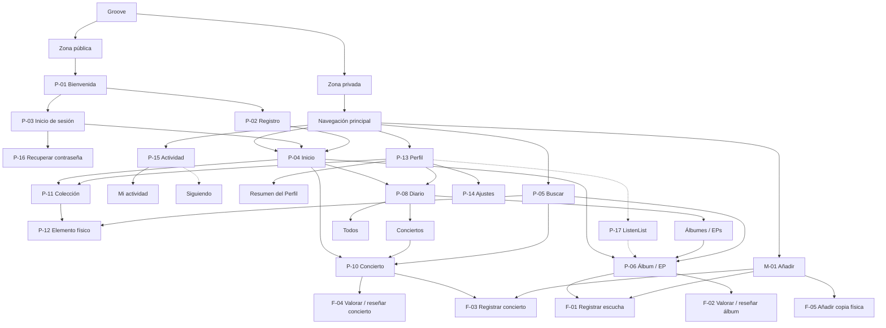

# Estructura de navegación — Groove

## 1. Objetivo

Este documento define la estructura de navegación de Groove, las relaciones entre sus pantallas y los principales recorridos que podrá realizar el usuario.

Groove combinará dos dimensiones:

- **Personal:** registro de escuchas, valoraciones, reseñas, experiencias de conciertos y colecciones musicales.
- **Social:** descubrimiento musical, consulta de actividad de otros usuarios e interacción dentro de una comunidad.

El desarrollo seguirá un enfoque incremental. La primera versión ofrecerá una experiencia personal completa, mientras que las funcionalidades de personalización y sociales se incorporarán progresivamente.

La navegación se dividirá en dos zonas: **pública y privada**.

La identificación y el estado de diseño de cada pantalla están documentadas en [Inventario de pantallas](inventario-pantallas.md).

Las decisiones sobre su distribución visual están documentadas en [Bocetos de interfaz](bocetos.md).

---

## 2. Organización de la interfaz

### 2.1. Tipos de elementos

La interfaz se organizará mediante cuatro tipos de elementos:

- **Pantallas (P):** páginas navegables que representan una funcionalidad o sección de Groove.
- **Vistas (V):** variantes, pestañas o filtros internos de una pantalla.
- **Modales (M):** elementos superpuestos sobre una pantalla, sin sustituirla completamente.
- **Formularios (F):** interfaces para registrar, modificar o eliminar información.

Los formularios podrán implementarse como pantallas independientes, modales o componentes integrados, según las necesidades de cada operación.

Cada elemento tendrá un identificador estable.

### 2.2. Navegación principal

La zona privada tendrá cinco elementos de navegación:

1. Inicio.
2. Buscar.
3. Añadir.
4. Actividad.
5. Perfil.

"Añadir" se considerará una acción global, no una página independiente.

La navegación será persistente y se adaptará al dispositivo utilizado.

---

## 3. Zona pública

La zona pública estará destinada a visitantes sin una sesión autenticada.

### 3.1. Bienvenida (P-01)

Será la pantalla de presentación de Groove.

Mostrará el nombre de la aplicación, una descripción de su propósito y las tres áreas funcionales principales:

- Diario musical.
- Conciertos.
- Colección física.

Permitirá acceder a Registro e Inicio de sesión.

### 3.2. Registro (P-02)

Permitirá crear una cuenta mediante:

- Nombre de usuario.
- Correo electrónico.
- Contraseña.
- Confirmación de contraseña.

Tras completar el registro y establecer una sesión válida, el usuario accederá a Inicio.

### 3.3. Inicio de sesión (P-03)

Permitirá autenticarse mediante nombre de usuario o correo electrónico y contraseña.

Incluirá acceso a Registro y al proceso de recuperación de contraseña.

### 3.4. Recuperación de contraseña

Se reservará una pantalla o flujo para recuperar el acceso a una cuenta.

Su comportamiento y alcance funcional deberán concretarse antes de su implementación.

### 3.5. Gestión de sesiones

Groove permitirá conservar la sesión autenticada entre accesos desde un mismo dispositivo o navegador mientras siga siendo válida.

- **Sesión válida:** acceso directo a Inicio.
- **Sesión inexistente o caducada:** acceso a la zona pública.
- **Cierre de sesión:** finalización de la sesión y regreso a la zona pública.

---

## 4. Zona privada

La zona privada constituirá el núcleo funcional de Groove y requerirá autenticación.

### 4.1. Inicio (P-04)

Será la página principal tras iniciar sesión.

Durante el MVP mostrará un resumen visual de la actividad musical personal mediante tres bloques:

#### Escuchas recientes

- Mostrará álbumes y EPs escuchados recientemente.
- Permitirá acceder a las fichas musicales y al Diario filtrado por Álbumes / EPs.

#### Conciertos destacados

- Mostrará una selección de conciertos registrados por el usuario.
- Permitirá acceder a las fichas correspondientes y al Diario filtrado por Conciertos.

#### Tu colección

- Mostrará una selección de elementos de la colección física.
- Permitirá acceder a los detalles de los elementos y a la colección completa.

Inicio será una pantalla de consulta rápida. No sustituirá al Diario ni al historial de Actividad.

En versiones posteriores incorporará descubrimiento musical, recomendaciones y actividad destacada de usuarios seguidos.

### 4.2. Buscar (P-05)

Permitirá buscar contenido musical dentro del catálogo disponible en Groove.

Tendrá tres categorías de resultados:

- **Álbumes / EPs (V-01).**
- **Conciertos (V-02).**
- **Ediciones físicas (V-03).**

La búsqueda permitirá acceder a las fichas correspondientes.

En el MVP, la búsqueda de conciertos y ediciones estará limitada a la información registrada o disponible en Groove.

Las integraciones externas adicionales podrán incorporarse posteriormente.

En versiones futuras se permitirá también buscar perfiles de usuario.

### 4.3. Añadir (M-01)

Añadir será una acción global disponible desde cualquier sección principal de la zona privada.

Al activarla se abrirá un menú con tres operaciones:

1. **Registrar escucha:** seleccionar un álbum o EP y registrar una escucha.
2. **Registrar concierto:** identificar o introducir un concierto y registrar una asistencia.
3. **Añadir a colección:** seleccionar una publicación musical y registrar una copia física.

La valoración y la reseña serán opcionales en los registros de escuchas y conciertos.

#### Disposición
- **Móvil**
  - Se utilizará un panel inferior superpuesto (*bottom sheet*).
  - El contenido de origen permanecerá visible detrás del panel.

- **Escritorio**
  - Se utilizará un cuadro de diálogo centrado (*modal*) sobre la pantalla actual.
  - El contenido de origen también permanecerá visible en el fondo.

#### Comportamiento general

- El menú deberá poder cerrarse sin perder el contexto anterior.
- Una vez seleccionada una operación, se abrirá el buscador o formulario correspondiente.
- Las mismas operaciones podrán iniciarse desde las fichas musicales.

### 4.4. Actividad (P-15)

Mostrará cronológicamente las acciones musicales registradas en Groove.

Se contemplarán dos vistas internas:

- **Mi actividad (V-04):** actividad personal del usuario.
- **Siguiendo (V-05):** actividad pública de usuarios seguidos.

Durante el MVP únicamente estará disponible Mi actividad.

Podrá mostrar:

- Escuchas registradas.
- Valoraciones y reseñas.
- Asistencias a conciertos.
- Incorporaciones a la colección física.

Las entradas se agruparán por periodos temporales y permitirán acceder al contenido correspondiente.

La vista "Siguiendo" se incorporará en la versión social v0.3.

### 4.5. Perfil (P-13)

El Perfil será el espacio central de la identidad musical del usuario.

Contendrá cuatro pestañas internas:

1. **Perfil:** información personal y resumen de actividad.
2. **Diario:** historial de experiencias musicales.
3. **Colección:** biblioteca de elementos físicos.
4. **ListenList:** publicaciones pendientes de escuchar.

Las tres primeras estarán disponibles en el MVP. ListenList se incorporará en la v0.2.

#### 4.5.1. Resumen del Perfil (P-13)

Mostrará:

- Nombre de usuario e identidad personal.
- Contador de álbumes registrados.
- Contador de conciertos registrados.
- Contador de elementos físicos.
- Álbumes favoritos.
- Actividad reciente.
- Resumen de la última escucha, el último concierto y el último elemento incorporado a la colección.

Los álbumes favoritos estarán disponibles desde la v0.2.

La actividad reciente será una selección limitada. El historial completo estará disponible en "Actividad" (P-15).

Los contadores tendrán los siguientes destinos:

- Álbumes → Diario filtrado por Álbumes / EPs.
- Conciertos → Diario filtrado por Conciertos.
- Colección → pestaña Colección.

El Perfil permitirá acceder también a "Ajustes".

#### 4.5.2. Diario musical (P-08)

El Diario reunirá todas las experiencias musicales personales en un único historial cronológico.

Incluirá:

- Escuchas de álbumes.
- Escuchas de EPs.
- Asistencias a conciertos.

No existirán diarios independientes para álbumes y conciertos.

El usuario podrá aplicar tres filtros:

- **Todos (V-06):** todas las experiencias.
- **Álbumes / EPs (V-07):** únicamente escuchas.
- **Conciertos (V-08):** únicamente asistencias.

Los registros se organizarán por meses y fechas.

Cada entrada mostrará la información relacionada con su tipo de experiencia.

Para álbumes y EPs:

- Fecha de escucha.
- Portada.
- Título.
- Artista.
- Valoración, cuando exista.

Para conciertos:

- Fecha.
- Artista.
- Recinto o lugar, cuando estén disponibles.
- Valoración, cuando exista.

Cada entrada permitirá acceder a su ficha o registro correspondiente.

La vista inicial del Diario mostrará Todos, salvo cuando se acceda mediante un enlace contextual que establezca un filtro.

La visualización mediante calendario se incorporará en la v0.2.

#### 4.5.3. Colección física (P-11)

Mostrará las copias físicas que pertenecen al usuario.

Se utilizará una cuadrícula de portadas con:

- Buscador interno.
- Filtro Todos (V-09).
- Filtro Vinilos (V-10).
- Filtro CDs (V-11).
- Acción Añadir.
- Acceso al detalle de cada elemento.

La búsqueda interna será independiente de Buscar (P-05).

La colección distinguirá entre:

- Publicación musical.
- Edición comercial.
- Copia física del usuario.

Se permitirá registrar varias copias de una misma publicación o edición.

#### 4.5.4. ListenList (P-17)

Permitirá guardar álbumes y EPs que el usuario tenga pendientes de escuchar.

Estará disponible desde la v0.2.

Incluirá:

- Cuadrícula de portadas.
- Buscador interno.
- Filtro Todos (V-12).
- Filtro Álbumes (V-13).
- Filtro EPs (V-14).
- Acción Añadir.

Seleccionar una publicación permitirá acceder a su ficha (P-06).

La incorporación de ListenList no será obligatoria para el MVP.

---

## 5. Pantallas de detalle

### 5.1. Ficha de álbum o EP (P-06)

Mostrará información de una publicación musical:

- Portada.
- Título.
- Artista o artistas.
- Tipo de publicación.
- Fecha o año de publicación.
- Lista de canciones.
- Información adicional disponible.

Permitirá:

- Registrar una escucha.
- Consultar la valoración personal.
- Crear o editar una reseña.
- Consultar registros personales relacionados.

Desde la v0.2 permitirá también añadir o eliminar la publicación de ListenList.

En versiones sociales podrá mostrar valoraciones agregadas, reseñas públicas y actividad de otros usuarios.

### 5.2. Ficha de concierto (P-10)

Mostrará:

- Artista o artistas.
- Fecha.
- Ciudad.
- Recinto.
- Información adicional disponible.

Permitirá:

- Registrar asistencia.
- Consultar el registro personal.
- Valorar y reseñar el concierto.
- Editar o eliminar registros propios.

En versiones posteriores podrá incorporar repertorios musicales y experiencias compartidas.

### 5.3. Elemento físico (P-12)

Mostrará información sobre una copia física de la colección personal.

Incluirá, cuando estén disponibles:

- Publicación musical asociada.
- Artista.
- Portada.
- Formato.
- Edición.
- Datos de la copia registrada.

Permitirá modificar o eliminar los datos de la copia física.

---

## 6. Formularios y elementos auxiliares

### 6.1. Formularios

Se contemplan los siguientes formularios funcionales:

- **F-01 — Registrar o editar escucha.**
- **F-02 — Valorar o reseñar álbum / EP.**
- **F-03 — Registrar o editar concierto.**
- **F-04 — Valorar o reseñar concierto.**
- **F-05 — Añadir o editar copia física.**

Los formularios de valoración y reseña podrán integrarse en los registros correspondientes, evitando pasos innecesarios.

La implementación visual definitiva se concretará durante el prototipado.

### 6.2. Confirmaciones

Se utilizará **M-02 — Confirmación de eliminación** cuando sea necesario confirmar una operación destructiva.

El componente podrá reutilizarse para registros personales, reseñas y copias físicas.

### 6.3. Ajustes (P-14)

Permitirá:

- Consultar y modificar información de cuenta.
- Gestionar opciones de seguridad.
- Cerrar sesión.

Las futuras opciones de privacidad social se incorporarán en este apartado.

---

## 7. Inventario y trazabilidad

La identificación completa de elementos se encuentra en [Inventario de pantallas](inventario-pantallas.md).

Se conservará la trazabilidad con la especificación original mediante las siguientes equivalencias:

| Identificador original | Nueva organización |
|---|---|
| P-07 — Valoración de álbum | F-02 — Formulario de valoración / reseña |
| P-09 — Conciertos | V-08 — Diario filtrado por Conciertos |

Los identificadores P-07 y P-09 se conservarán como referencias históricas, pero no corresponderán a nuevas pantallas independientes.

Se incorporarán dos identificadores:

- **P-16 — Recuperación de contraseña:** flujo pendiente de concretar.
- **P-17 — ListenList:** pantalla prevista para la v0.2.

La acción Añadir tendrá el identificador M-01.

---

## 8. Mapa de navegación

El siguiente diagrama representa las relaciones principales entre las zonas y pantallas de Groove.

Las conexiones discontinuas indican funcionalidades futuras.

El diagrama muestra las conexiones principales, no todas las transiciones posibles.

---

## 9. Recorridos principales

### 9.1. Autenticación

| Operación | Recorrido |
|---|---|
| Registro | Bienvenida → Registro → Inicio |
| Inicio de sesión | Bienvenida → Inicio de sesión → Inicio |
| Sesión existente | Acceso → validación de sesión → Inicio |
| Cierre de sesión | Ajustes → cerrar sesión → zona pública |

### 9.2. Diario musical

| Operación | Recorrido |
|---|---|
| Consultar diario | Perfil → Diario → Todos |
| Consultar escuchas | Perfil → Diario → Álbumes / EPs |
| Consultar conciertos | Perfil → Diario → Conciertos |
| Registrar escucha | Añadir → seleccionar publicación → formulario → Diario |
| Registrar concierto | Añadir → seleccionar o introducir concierto → formulario → Diario |
| Valorar publicación | Ficha de álbum / EP → valoración / reseña |

### 9.3. Colección física

| Operación | Recorrido |
|---|---|
| Consultar colección | Perfil → Colección |
| Filtrar colección | Colección → Todos / Vinilos / CDs |
| Consultar copia | Colección → Elemento físico |
| Añadir copia | Añadir → seleccionar publicación / edición → registrar copia |
| Editar copia | Elemento físico → editar información |

### 9.4. Actividad y perfil

| Operación | Recorrido |
|---|---|
| Consultar actividad | Menú principal → Actividad → Mi actividad |
| Consultar ficha desde actividad | Actividad → registro → ficha relacionada |
| Consultar perfil | Menú principal → Perfil |
| Consultar conciertos desde perfil | Perfil → contador Conciertos → Diario filtrado |
| Consultar toda la actividad | Perfil → Ver toda la actividad → Actividad |
| Modificar cuenta | Perfil → Ajustes |

### 9.5. Funcionalidades futuras

| Operación | Versión |
|---|---|
| Consultar álbumes favoritos | v0.2 |
| Consultar ListenList | v0.2 |
| Añadir álbum a ListenList | v0.2 |
| Consultar actividad de seguidos | v0.3 |
| Acceder a perfiles públicos | v0.3 |

---

## 10. Navegación adaptable

### 10.1. Móvil

La navegación principal utilizará una barra inferior con cinco elementos.

El botón Añadir tendrá una posición destacada.

El menú Añadir se mostrará mediante un panel inferior superpuesto.

La navegación del Perfil utilizará pestañas horizontales.

Las pantallas de resultados, Diario, Colección y ListenList se adaptarán al ancho del dispositivo.

### 10.2. Escritorio

La navegación principal utilizará un menú lateral persistente.

El menú Añadir se mostrará mediante un diálogo centrado.

El Perfil mantendrá las mismas pestañas internas que en móvil.

Las cuadrículas, carruseles y listados aprovecharán el espacio horizontal disponible sin modificar los recorridos principales.

### 10.3. Accesibilidad y comportamiento

La interfaz deberá:

- Mantener una navegación comprensible.
- Identificar la sección activa.
- Permitir regresar al contexto anterior.
- Evitar pérdidas de información durante la navegación.
- Facilitar el uso mediante teclado y tecnologías de asistencia.
- Adaptarse a diferentes tamaños de pantalla.
- Mantener accesibles las operaciones principales.

---

## 11. Evolución por versiones

| Versión | Alcance |
|---|---|
| **v0.1 — MVP** | Autenticación, Inicio, Buscar, Añadir, Actividad personal, Perfil, Diario unificado, conciertos y colección física. |
| **v0.2 — Personalización** | Favoritos, ListenList, calendario musical y mejoras del perfil. |
| **v0.3 — Red social** | Perfiles públicos, seguimiento, actividad social, reseñas públicas e interacciones. |
| **v0.4 — Descubrimiento** | Recomendaciones, exploración y compatibilidad musical. |
| **v1.0 — Plataforma ampliada** | Nuevas integraciones, aplicación móvil y funcionalidades adicionales. |

Las funcionalidades futuras podrán representarse en los bocetos y prototipos, pero deberán diferenciarse de las incluidas en el MVP.

---

## 12. Principios de navegación

1. Mantener una estructura principal sencilla y estable.
2. Diferenciar las pantallas de sus vistas internas.
3. Evitar duplicaciones funcionales innecesarias.
4. Centralizar las experiencias musicales en un Diario unificado.
5. Facilitar el registro mediante la acción global Añadir.
6. Organizar la información personal mediante el Perfil.
7. Permitir acceder a una misma ficha desde distintos recorridos.
8. Mantener la coherencia entre móvil y escritorio.
9. Proteger los datos personales y las operaciones autenticadas.
10. Mantener la utilidad individual independientemente de las funciones sociales.
11. Permitir la evolución incremental sin reorganizaciones innecesarias.
